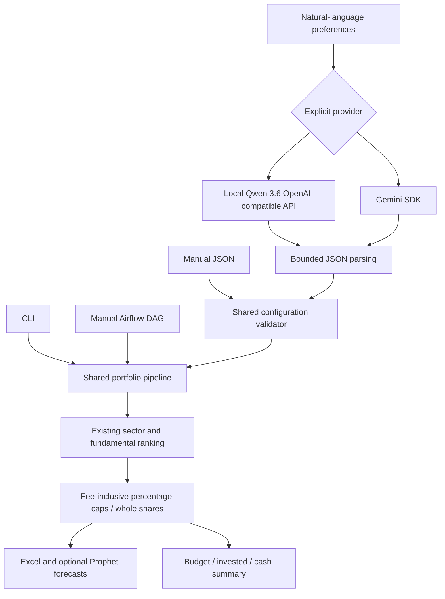

# Add optional Qwen 3.6 configuration tool, fee-safe allocation and Airflow research DAG

**Proposed head:** `blue-qwen36-airflow`
**Proposed base:** `blue-master`
**PR type:** enhancement, bug fix, test coverage
**Status:** local review packet only — no GitHub PR exists yet.

## Summary

Extend the portfolio builder without replacing its sector/fundamental ranking or Excel/Prophet capabilities:

- Add an optional OpenAI-compatible **Qwen 3.6 smol friend** configuration tool, retaining Gemini and manual JSON modes.
- Validate LLM/manual configurations before financial calculations, market requests and output writes.
- Replace fee-induced overspending and percentage-breaking residual allocation with whole-share allocation under explicit position caps.
- Add a noninteractive, Linux/headless CLI and a manual-trigger Airflow DAG that reuse the same pipeline.
- Add a compact workbook-sidecar budget/cash summary, regression coverage, reproducible Linux dependencies and a read-only CI workflow.

This follows [PR #14](https://github.com/orionnelson/stock_portfolio_maker/pull/14)'s summary/diagram/file-walkthrough approach, with explicit evidence and release gates. That PR is already included in this branch's exact upstream baseline.

## Architecture walkthrough

## File walkthrough

| Files | Purpose |
| --- | --- |
| `portfolio_llm.py` | Explicit provider routing, lazy cloud SDK/key use, OpenAI-style tool schema/dispatcher, bounded response parsing, redirect refusal and no silent cloud fallback. |
| `portfolio_config.py` | Shared numeric/period/ticker/allocation validation; output restricted to a workbook basename. |
| `portfolio_budget.py` | Decimal-backed hard percentage caps, actual fees only for funded positions, unallocated cash preserved, exact budget invariant. |
| `portfolio_cli.py` | Manual/natural-language CLI, validate-only mode, headless shared pipeline, optional forecasts and cash summary. |
| `make_fast_portfolio.py` | Preserve ranking and export functions; delegate allocation/entry point, make Windows COM and Prophet imports conditional/lazy, bound HTTP waits. |
| `cgemini1206exp.py` | Keep existing helper API while delegating to the validated provider implementation. |
| `dags/stock_portfolio_research.py` | Manual-only DAG, no parse-time network work, shared pipeline, hashed per-run output paths, small summary XCom. |
| `tests/test_upgrade.py` | Adapter/security boundaries, allocation invariants, real Excel/Prophet with synthetic inputs, explicit stubbed DAG adapter tests. |
| `requirements.txt`, `requirements-tested.lock` | Correct Google SDK/Linux dependency handling; tested Linux dependency snapshot. |
| `.github/workflows/tests.yml` | PR/manual regression workflow with read-only repository permissions; no publishing/merge jobs. |
| `README.md`, `.env.example`, `.gitignore`, `QA_RESULTS.md` | Setup, tool/CLI/DAG usage, secret hygiene, compatibility changes and verification limits. |

## Intentional compatibility changes

- No-argument legacy invocation still prompts for Gemini. Explicit manual JSON requires no cloud key or SDK initialization.
- Gemini defaults to configurable `gemini-2.5-flash`, replacing the old 1.5 identifier.
- Windows Excel COM is optional; headless runs do not try to display charts unless `--plots` is selected.
- Invalid model/manual configs now fail early rather than passing unchecked values into calculations.
- **Allocation percentages now include fees and are hard caps.** Rounding/unallocated money stays cash; the old residual loop could exceed those allocations. This can result in fewer shares than before and is deliberately tested.
- `output_filename` is a basename, with filesystem location controlled by `--output-dir` or the operator-managed DAG output root.

## Test evidence

- [x] **69 tests passed**, including 500 deterministic budget cases.
- [x] Real loopback HTTP verifies Qwen-compatible transport; malformed responses/redirects/timeouts fail closed.
- [x] Real legacy stock selection with synthetic fundamentals.
- [x] Real Excel export and real Prophet fits with synthetic history.
- [x] Manual config validation, Python compilation, `pip check`, whitespace check.
- [x] Independent OpenCode review; all three reproduced allocation findings fixed with regressions.
- [ ] Real Qwen generation and cloud Gemini authentication — not performed.
- [ ] Live market-data end-to-end run — not performed.
- [ ] Real Airflow 3.3.2 parse/worker acceptance — adapter tests use an explicit stub.
- [ ] Windows integration and GitHub CI — not performed.

Full scope and limitations: `QA_RESULTS.md`.

## Security and operational considerations

No trade execution, automatic provider fallback, model load/unload, secret logging, production deployment, email delivery or scheduling. The DAG is manual-only, with one active run and no automatic retry. Provider endpoints and storage roots are operator-owned, not LLM/DAG-trigger output. Existing pickle caches require trusted local storage and remain an identified follow-up item, not an audited-safe untrusted format.

## Reviewer checklist

1. Run `python -m pip install -r requirements-tested.lock && python -m pytest -q` on Python 3.11/Linux.
2. Inspect fee/cash behavior and confirm hard percentage caps are the desired allocation semantics.
3. Run the validate-only manual CLI, then an explicitly approved Qwen fixture request against the correct model endpoint.
4. Review the DAG with your real Airflow worker image and dependency constraints; no deployment is part of this PR.
5. Human-merge this feature PR into `blue-master` only after review. No auto-merge is enabled.
6. After that merge, open a separate `blue-master` → **`main`** release PR carrying this evidence and the remaining acceptance gates. Humans own release/merge decisions.

## Rollback

Before release, close/revert the feature PR; after a human merge, revert its commit on the appropriate reviewed branch. No database migration, production service change or deployed DAG needs rollback from this work.
